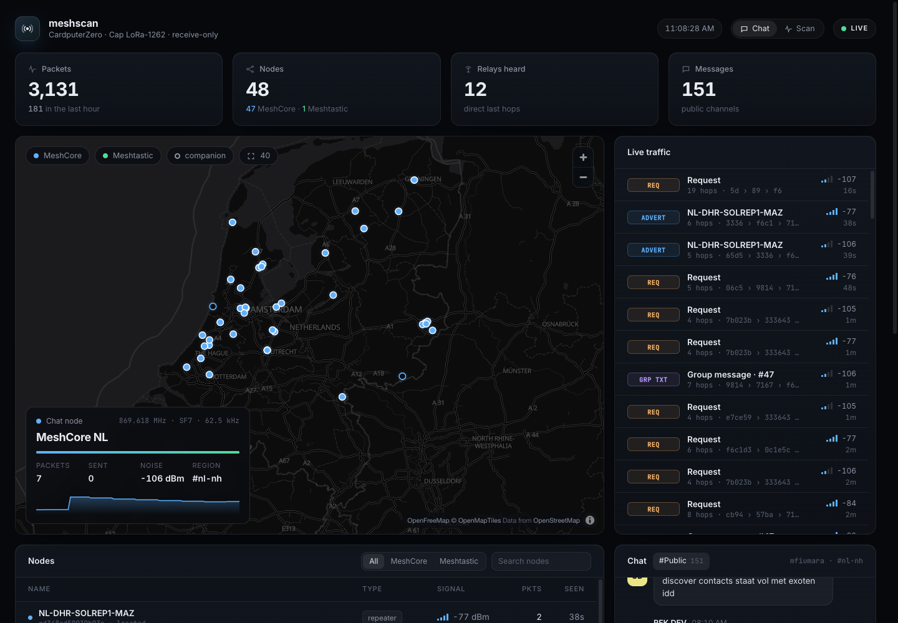
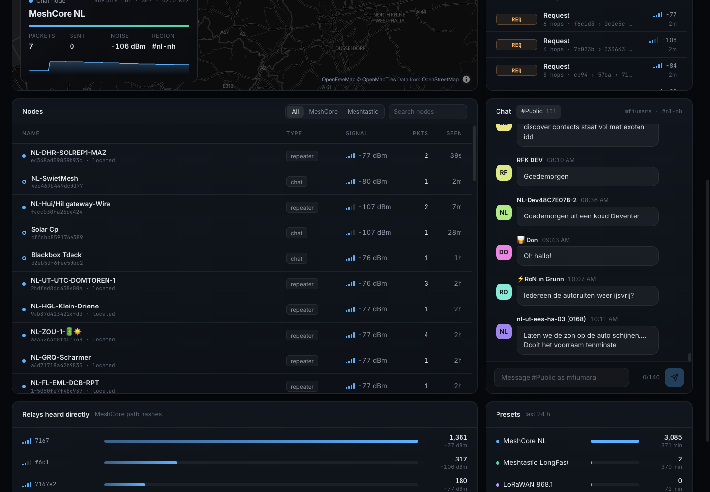

# meshscan-zero

A LoRa scanner, MeshCore chat node and web dashboard for the M5Stack **CardputerZero** with the **Cap LoRa-1262** (SX1262).

I put my Cardputer next to the window, listened on Meshtastic LongFast for 10 minutes and heard nothing. Turns out the Dutch MeshCore network moved to SF7 in May 2026, and I was listening on the wrong settings. Once I fixed that, it picked up 66 packets in 10 minutes from repeaters all over Noord-Holland.

So meshscan hops between presets, saves everything it hears to SQLite, and shows the nodes on a map you can open from your phone or laptop.





## What it does

- Two modes, switched from the dashboard:
  - **Scan:** drives the SX1262 directly over SPI and hops between presets. **Never transmits.**
  - **Chat:** runs a real MeshCore node (openhop-core) on the MeshCore NL settings, so you can read and send on the Public channel from the browser.
- Cycles through presets (defaults below; override with `/etc/meshscan.json`).
- Stores every packet with RSSI, SNR, raw bytes, and CRC status, plus per-preset counters for preambles and headers, so you can see activity even when nothing decodes.
- **MeshCore:** decodes adverts (name, type, location, public key), logs the relay path, and decrypts the Public group channel (verified on air: 166 Public messages overnight in Amsterdam).
- **Meshtastic:** decrypts the default channel (`AQ==`) and extracts node info, position, telemetry, and text.
- Keeps a node table (first seen, last seen, packet count, last RSSI/SNR), like a normal mesh node does.
- Serves a live dashboard on port 8080: packets stream in over Server-Sent Events, nodes on a MapLibre vector map (OpenFreeMap, no API key), what the radio is listening to right now, noise floor, relays, presets, and messages. Works on phones too.

| Slot | Freq | SF | BW | Dwell |
|---|---|---|---|---|
| MeshCore NL | 869.618 MHz | 7 | 62.5 kHz | 10 min |
| Meshtastic LongFast | 869.525 MHz | 11 | 250 kHz | 10 min |
| Meshtastic MediumFast | 869.525 MHz | 9 | 250 kHz | 5 min |
| MeshCore EU/UK Narrow | 869.618 MHz | 8 | 62.5 kHz | 3 min |
| LoRaWAN 868.1 | 868.1 MHz | 7 | 125 kHz | 2 min |

## Chat mode

Chat mode turns the Cardputer into a MeshCore companion node and adds a chat window to the dashboard: channel tabs, live messages, and a composer. Your own messages show `sent`, then `heard repeated N×` once a repeater is heard re-broadcasting them. That is the only delivery signal a flood mesh gives you.

It's opt-in, because it transmits. Edit `/etc/meshscan.json`:

```json
{
  "default_mode": "chat",
  "node": {
    "name": "your-name",
    "scope": "nl-nh",
    "channels": [{"name": "#amsterdam"}]
  }
}
```

- `name` is shown next to every message you send.
- `scope` is the MeshCore region your floods are tagged with. Dutch repeaters drop untagged floods since strict-region forwarding, so set this to your province code (`nl-nh`, `nl-ut`, …) or `nl`. See meshwiki.nl.
- `channels` adds channels after Public. `#hashtag` channels derive their key from the name; private ones need `"psk"` (base64).
- Radio defaults to the Dutch MeshCore settings (869.618 MHz, SF7, 62.5 kHz, CR5). Override with `"radio": {"frequency_hz": …, "spreading_factor": …}`.

Chat mode uses [openhop-core](https://github.com/openhop-dev/openhop-core) (MIT) and the board bring-up from MeshTerm's `radionode.py` (Apache-2.0). Both ship with MeshTerm on the CardputerZero image (`/usr/lib/meshterm/site`).

While in chat mode the radio stays on one preset, so the Meshtastic/LoRaWAN slots aren't scanned. Switch back to Scan in the header.

## Install

On the CardputerZero (Raspberry Pi OS trixie):

```sh
git clone https://github.com/mfiumara/meshscan-zero && cd meshscan-zero
sudo ./install.sh
```

Then open `http://cardputerzero.local:8080`. Summarize in the terminal with `meshscan-report` (optional argument: hours).

The radio can only be used by one program at a time. To use MeshTerm, the Cap-LoRa-1262 app or `meshtasticd`, run `sudo systemctl stop meshscan` first.

Anyone who can reach port 8080 can send messages as your node while chat mode is on. Keep it on a network you trust.

## Hardware notes

The cap needs power before the SX1262 responds. meshscan switches on `/sys/class/leds/ext_5v_out` and drives PI4IOE5V6408 P0 high (I²C1, 0x43). Pinout follows Meshtastic's `lora-cardputer-zero.yaml`: spidev0.1, BUSY GPIO22, RESET GPIO26, DIO2 as RF switch, TCXO 3.0 V on DIO3.

## Status

This is a weekend-afternoon tool, tested on one CardputerZero v5 in Amsterdam.

- Verified on air: MeshCore adverts, relay paths, Meshtastic NodeInfo decryption, and chat-mode TX (a region-scoped group message, heard repeated by a nearby repeater).
- Not verified on air yet: Meshtastic position and text, and the LoRaWAN slot.
- Only the EU868 presets are set up. Other regions need a different config.
- Uses polling instead of DIO1 interrupts. That's fine for logging, but it's not a real node.

## License

GPL-3.0. See [LICENSE](LICENSE). meshscan uses the GPL-3.0 `meshtastic` Python package for its protobuf definitions.
