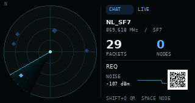
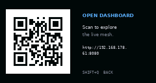

# meshscan-zero

A LoRa scanner, MeshCore chat node and web dashboard for the M5Stack **CardputerZero** with the **Cap LoRa-1262** (SX1262).

I put my Cardputer next to the window, listened on Meshtastic LongFast for 10 minutes and heard nothing. Turns out the Dutch MeshCore network moved to SF7 in May 2026, and I was listening on the wrong settings. Once I fixed that, it picked up 66 packets in 10 minutes from repeaters all over Noord-Holland.

So meshscan hops between presets, saves everything it hears to SQLite, and shows the nodes on a map you can open from your phone or laptop.


## What it does

- **Two modes**, switched from the dashboard header:
  - **Scan:** drives the SX1262 directly over SPI and hops between presets. **Never transmits.**
  - **Chat:** runs a real MeshCore node ([openhop-core](https://github.com/openhop-dev/openhop-core)) so you can read and send on Public and your own channels from the browser.
- Stores every packet with RSSI, SNR, raw bytes and CRC status, plus per-preset counters for preambles and headers, so you see activity even when nothing decodes.
- **MeshCore:** decodes adverts (name, type, location, public key), logs the relay path, decrypts the Public channel.
- **Meshtastic:** decrypts the default channel (`AQ==`): node info, position, telemetry, text.
- Keeps a node table (first/last seen, packets, last RSSI/SNR), like a normal mesh node does.
- Live dashboard on port 8080: packets stream in over Server-Sent Events, nodes on a MapLibre vector map (OpenFreeMap, no API key), chat window, what the radio is doing right now, noise floor, relays and presets. Works on phones.

## Install

On the CardputerZero (Raspberry Pi OS trixie, Cap LoRa-1262 attached):

```sh
git clone https://github.com/mfiumara/meshscan-zero && cd meshscan-zero
sudo ./install.sh
```

Then open `http://cardputerzero.local:8080`. The first visit walks you through a short setup:

1. **Node name**, shown next to every message you send.
2. **Region:** Netherlands (MeshCore NL), EU/UK (Narrow) or USA/Canada, plus the region tag your floods carry. Dutch repeaters drop untagged floods, so pick your province (`#nl-nh`, `#nl-ut`, …) or the whole country.
3. **PIN:** anyone on your network can watch the dashboard; sending, switching modes and changing settings need the PIN.
4. **Start in Chat or Scan**, and optionally a home location for the on-device radar.

Until setup is done the radio stays in Scan mode and never transmits. Everything is changeable later under ⚙ Settings (saving restarts the radio, about 10 s), including extra `#hashtag` channels (key derived from the name) and private channels (base64 key).

Remove it with `sudo ./uninstall.sh` (keeps your data) or `sudo ./uninstall.sh --purge`. Summarize from the terminal with `meshscan-report [hours]`.

The radio can only be used by one program at a time. To use MeshTerm, the Cap-LoRa-1262 app or `meshtasticd`, run `sudo systemctl stop meshscan` first.

## Region presets

| Region | Chat (MeshCore) | Scan hops through |
|---|---|---|
| Netherlands | 869.618 MHz · SF7 · 62.5 kHz · CR5 | MeshCore NL, Meshtastic LongFast + MediumFast, MeshCore EU/UK Narrow, LoRaWAN 868.1 |
| EU / UK | 869.618 MHz · SF8 · 62.5 kHz · CR8 (EU/UK Narrow) | MeshCore EU/UK Narrow, Meshtastic LongFast + MediumFast, MeshCore NL, LoRaWAN 868.1 |
| USA / Canada | 910.525 MHz · SF7 · 62.5 kHz · CR5 | MeshCore US, Meshtastic US LongFast |

Sources: meshwiki.nl (NL switch to SF7, May 2026), the MeshCore app preset list as documented by meshcore-info.eu and getuncabled (EU/UK Narrow), MeshCore Zero docs (US). Make sure your Cap matches your band: an 868 MHz radio doesn't become a 915 MHz radio by picking USA.

## Chat mode

The chat window has channel tabs, live messages and a composer. Your own messages show `sent`, then `heard repeated N×` once a repeater is heard re-broadcasting them. That's the only delivery signal a flood mesh gives you; on a busy mesh some messages collide and are never heard back.

Your node doesn't send adverts, so it won't show up in other people's contact lists, but your name is in every message. While in chat mode the radio stays on one preset, so the other scan slots aren't visited.

## On-device radar

The optional **Mesh Radar** APPLaunch app shows a sweeping scope, live packet/node counts, signal and noise, and a QR link to the dashboard. Diamonds are repeaters/relays; dots are other nodes. With a configured home location, located nodes use bearing and log-scaled distance; otherwise the angle is stable but arbitrary and radius approximates signal strength. It reads only the local HTTP API and keeps retrying if the web service is unavailable.

```sh
sudo ./device/install-radar.sh
```

Launch **Mesh Radar** from APPLaunch. **Shift+Q** toggles the full-screen dashboard QR; **Space** or **Tab** cycles nodes by signal strength; **Esc** or lowercase **q** exits. The dashboard URL is also visible in the QR view. The installer uses a separate venv under `/opt/meshscan-radar` and does not restart meshscan services.




## Hardware notes

The cap needs power before the SX1262 responds. meshscan switches on `/sys/class/leds/ext_5v_out` and drives PI4IOE5V6408 P0 high (I²C1, 0x43). Pinout follows Meshtastic's `lora-cardputer-zero.yaml`: spidev0.1, BUSY GPIO22, RESET GPIO26, DIO2 as RF switch, TCXO 3.0 V on DIO3.

## Status

Preview. Tested on one CardputerZero v5 in Amsterdam.

- Verified on air (Amsterdam, NL preset): MeshCore adverts, relay paths, Public channel decryption, Meshtastic NodeInfo decryption, and chat-mode TX (region-scoped group messages heard repeated by nearby repeaters).
- Verified install: `install.sh` from a fresh clone on a purged device with MeshTerm hidden, then setup, scan, chat and send.
- Not verified on air: the EU/UK Narrow and US presets (no such mesh in range here), Meshtastic position/text, the LoRaWAN slot.
- Scan mode polls the SX1262 instead of using DIO1 interrupts. Fine for logging, but scan mode isn't a node; chat mode is.

## License

GPL-3.0. See [LICENSE](LICENSE). `meshscan_board.py` is adapted from MeshTerm (Apache-2.0); see [NOTICE](NOTICE). Chat mode uses openhop-core (MIT) and decoding uses the GPL-3.0 `meshtastic` Python package.
